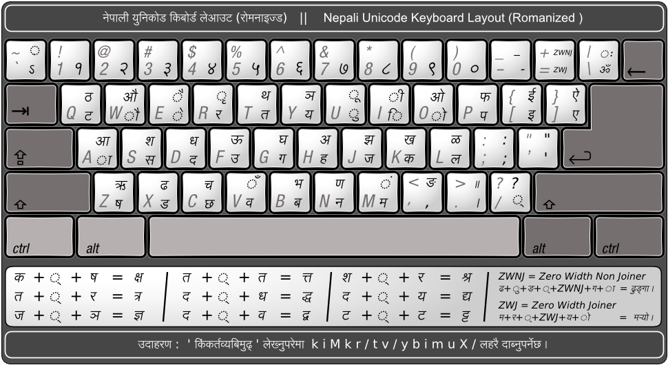

# Nepali Input

A vanilla JavaScript plugin that converts Romanized Nepali (English keyboard) input into Devanagari script on `<input>` and `<textarea>` elements.

## Usage

### Default (auto-detect)

```html
<input class="nepali-input" type="text">

<script src="NepaliInput.js"></script>
<script>
  NepaliInput.init(); // auto-hooks all .nepali-input elements
</script>

### Custom selector

```html
<input class="my-custom-input" type="text">

<script src="NepaliInput.js"></script>
<script>
  NepaliInput.init('.my-custom-input'); // hooks only matching elements
</script>
```

## API

- **`NepaliInput.init(selector?)`** — Initialize the plugin on target elements
- **`NepaliInput.init(selector, { mappings })`** — Override the default character mapping table
- **`NepaliInput.VERSION`** — Current plugin version string

### Selector Options

| Type | Behavior |
|---|---|
| CSS selector string | Hooks matching elements |
| `HTMLElement` | Hooks that single element |
| `undefined` (default) | Auto-detects all elements with `class="nepali-input"` |

## How It Works

The plugin intercepts `keydown` events on target elements. When a mapped key is pressed, it prevents the default and inserts the corresponding Devanagari character at the cursor position. Navigation keys (Arrow, Tab, Escape, Enter, etc.) pass through normally.

Shift behavior varies by key — some keys produce different Devanagari characters when combined with Shift, others produce symbols.

## Keyboard Layout



## Testing

Open `Sample/Sample.html` in a browser for manual testing.

## License

[MIT](LICENSE)
